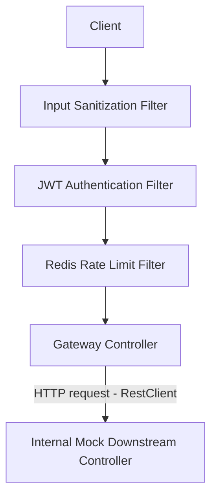
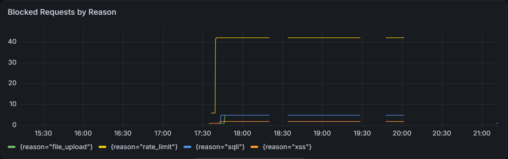
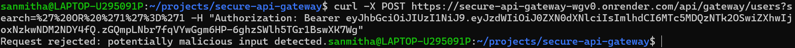
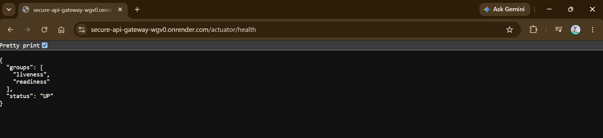

# Secure API Gateway

A Spring Boot API gateway that centralizes authentication, request
sanitization, rate limiting, and observability in front of backend
services - so individual services don't need to reimplement these
checks themselves.

**Live demo:** https://secure-api-gateway-wgv0.onrender.com/
*(free-tier hosting - the service spins down after 15 min of
inactivity and takes ~1 min to wake on the first request)*

## Why this project

Built to demonstrate, as a standalone and fully testable project, the
same "centralize the security check once, apply it everywhere"
pattern used in production systems that harden many REST endpoints at
once - rather than patching each endpoint individually.

## Features

- **JWT authentication** at the gateway edge - a single filter
  establishes identity before any request reaches business logic
- **Input sanitization** - SQL Injection and XSS detection via
  canonicalization (closes common encoding-bypass tricks) and
  structural pattern matching, deliberately avoiding naive keyword
  blacklisting to reduce false positives on legitimate input
- **Malicious file upload validation** - verifies actual file content
  via Apache Tika (magic-byte detection), not just filename/
  Content-Type headers, which are trivially spoofable
- **Redis-backed rate limiting** - fixed-window, per-user (falls back
  to per-IP for unauthenticated requests), correct across multiple
  gateway instances since state lives in Redis, not memory
- **Prometheus metrics** - custom counters tracking blocked requests
  by reason (`sqli`, `xss`, `rate_limit`, `file_upload`), visualized
  in a Grafana dashboard
- **Fully containerized** - one `docker compose up` starts the
  gateway, Redis, Prometheus, and Grafana together

## Try it live

The demo is deployed at **https://secure-api-gateway-wgv0.onrender.com**

> Free-tier note: the service sleeps after 15 minutes of inactivity.
> The first request may take up to 60 seconds to wake it.
> To keep it warm, add a UptimeRobot monitor pinging `/actuator/health` every 5 minutes.

### 1. Get a token

```bash
curl -s -X POST https://secure-api-gateway-wgv0.onrender.com/api/auth/login \
  -H "Content-Type: application/json" \
  -d '{"username":"demo","password":"demo1234"}' | jq .
```
Expected:
```json
{ "token": "<jwt>" }
```

```bash
TOKEN=<paste the token value here>
BASE=https://secure-api-gateway-wgv0.onrender.com
```

### 2. Normal request — passes

```bash
curl -s -H "Authorization: Bearer $TOKEN" "$BASE/api/gateway/users"
```
Expected: `[{"id":1,"name":"Alice"},{"id":2,"name":"Bob"}]`

### 3. SQL injection — blocked

```bash
curl -s "$BASE/api/gateway/users?search=%27%20OR%20%271%27%3D%271" \
  -H "Authorization: Bearer $TOKEN"
```
Expected: HTTP 400 with `Request rejected: potentially malicious input detected.`

### 4. XSS — blocked

```bash
curl -s "$BASE/api/gateway/users?comment=%3Cscript%3Ealert(1)%3C%2Fscript%3E" \
  -H "Authorization: Bearer $TOKEN"
```
Expected: HTTP 400 with `Request rejected: potentially malicious input detected.`

### 5. Spoofed file upload — rejected

```bash
echo "this is not an image" > fake.png
curl -s -X POST "$BASE/api/gateway/upload" \
  -H "Authorization: Bearer $TOKEN" \
  -F "file=@fake.png"
```
Expected: HTTP 400 with `Rejected: File content does not match its declared type (claimed: image/png, detected: text/plain).`

### 6. Rate limit — triggers after 20 requests

```bash
for i in $(seq 1 25); do
  curl -s -o /dev/null -w '%{http_code} ' -H "Authorization: Bearer $TOKEN" "$BASE/api/gateway/users"
done; echo
```
Expected: `200 200 200 … 200 429 429 429 429 429`
(20 successes, then 5 rejections)

### 7. Grafana dashboard

Prometheus and Grafana run locally alongside the app.
Start the full stack with `docker compose up --build` and open
`http://localhost:3000` (login `admin` / `admin`).

## Monitoring & Observability

The application exposes custom security metrics through Spring Boot Actuator and Micrometer. Prometheus collects these metrics, and Grafana provides a dashboard to visualize blocked requests.

The local Docker Compose setup includes:

- **Prometheus** – scrapes application metrics from the gateway.
- **Grafana** – visualizes security events using Prometheus as its data source.
- **Micrometer counters** – track blocked requests by rejection reason.

### Security Metrics

The `gateway.security.blocked` counter is tagged by rejection reason:

| Reason | Description |
|---|---|
| `sqli` | Requests blocked by SQL injection detection |
| `xss` | Requests blocked by cross-site scripting detection |
| `file_upload` | Uploads rejected by file validation |
| `rate_limit` | Requests rejected after exceeding the rate limit |

### View the Dashboard Locally

Start the application and monitoring stack:

```bash
docker compose up -d --build
```

Access the services locally:

| Service | URL |
|---|---|
| Gateway | http://localhost:8080 |
| Prometheus | http://localhost:9090 |
| Grafana | http://localhost:3000 |
| Gateway metrics | http://localhost:8080/actuator/prometheus |

Open Grafana and view the **Blocked Requests by Reason** dashboard.

## Architecture



The gateway makes an HTTP request to an internal mock endpoint in the same application deployment; the downstream service is not separately deployed.

Each filter is a centralized checkpoint, rather than repeating checks per endpoint.

## Tech stack

Java 25 · Spring Boot 4.1 · Spring Security 7 · Redis (Lettuce) ·
Apache Tika · Micrometer/Prometheus · Docker Compose · JUnit 5 /
AssertJ

## Running locally

**Requires:** JDK 25, Docker & Docker Compose

```bash
export JWT_SECRET="<a real 256-bit base64 secret - generate via: openssl rand -base64 32>"
docker compose up --build
```

This starts:
- Gateway → `http://localhost:8080`
- Prometheus → `http://localhost:9090`
- Grafana → `http://localhost:3000` (login: `admin` / `admin`)

### Try it out

Get a JWT using the demo credentials:

```bash
curl -s -X POST http://localhost:8080/api/auth/login \
  -H "Content-Type: application/json" \
  -d '{"username":"demo","password":"demo1234"}'
```

Copy the `token` value from the response and set it:
```bash
TOKEN="<paste-your-token-here>"
```

Call a protected route:
```bash
curl http://localhost:8080/api/gateway/users \
  -H "Authorization: Bearer $TOKEN"
```

Try a request without a token:
```bash
curl -i http://localhost:8080/api/gateway/users
```

## Screenshots

**Grafana dashboard - blocked requests by reason:**


**A SQL injection attempt blocked on the live deployment:**


**Live health check:**


## Limitations

- **Mock downstream service:** No real database is connected behind the downstream service. The project focuses on gateway-level security controls.
- **Local monitoring:** Prometheus and Grafana are available through Docker Compose for local demonstration; they are not hosted with the public Render deployment.
- **Fixed-window rate limiting:** The Redis-backed rate limiter uses fixed 60-second windows. Requests near a window boundary may temporarily exceed the nominal limit across two adjacent windows.
- **Heuristic input detection:** SQL injection and XSS detection use pattern matching and canonicalization. These controls are defense-in-depth measures, not replacements for parameterized queries, output encoding, and other application-level protections.

## Design Decisions and Trade-offs

### Structural pattern matching over keyword blacklists

The input sanitization filter uses canonicalization and pattern-based detection rather than blocking requests based on suspicious keywords alone. Keyword blacklists can reject legitimate input containing terms such as `select` or `script`, while missing payloads that use encoding or formatting variations.

This approach improves detection of common SQL injection and XSS payloads, but it is still heuristic. It cannot replace parameterized queries, context-aware output encoding, or other protections at the application layer.

### File content validation over client-supplied metadata

File uploads are validated using Apache Tika to inspect file content and detect its type. The validator does not trust the filename or the `Content-Type` header, since both are controlled by the client and can be spoofed.

Magic-byte and content-based detection provides a stronger signal than metadata alone, but it does not prove that a file is harmless. Production systems should also consider file size limits, storage isolation, malware scanning, and safe file handling.

### Redis-backed rate limiting over in-memory counters

Rate-limit state is stored in Redis instead of local application memory. This allows multiple gateway instances to share the same request counters and avoids each instance enforcing an independent limit.

The current implementation uses a fixed-window algorithm because it is straightforward and efficient. Its trade-off is the possibility of bursts around window boundaries. A sliding-window or token-bucket algorithm would provide smoother traffic control at higher scale.

### A mock downstream service for focused gateway testing

The downstream endpoint is intentionally mocked and runs within the same application deployment. This keeps the project focused on demonstrating gateway-level security controls without introducing a separate service or database.

The trade-off is that this setup does not demonstrate network-level isolation, service-to-service authentication, or failure handling across independently deployed services.

## What I'd improve at scale

- Replace the environment-configured demo credentials with a persistent user store and proper password hashing
- Move from fixed-window to a sliding-window or token-bucket rate
  limiter to close the window-boundary burst issue
- Split the downstream mock service into an actually separate
  deployment, to prove the gateway pattern across a real network
  boundary rather than same-process routing
- Key rotation support (multiple valid signing keys via a `kid`
  claim), rather than a single static JWT secret
- A hosted, always-on observability stack instead of local-only
  Grafana

## License

This project is licensed under the [MIT License](LICENSE).